# Advanced Ballistic Analytics and Simulation Platform
## System Architecture & Technical Specification

> [!IMPORTANT]
> **Academic & Research Compliance Disclaimer**
> This platform is developed strictly for academic machine learning research, educational visualization, and computational physics demonstration. It does NOT generate operational weapon guidance, targeting solutions, or real-world weapon optimization.

---

## 1. System Overview & Architecture Diagram

The system follows a clean modular decoupled architecture: a React + Vite + TypeScript frontend communicating via HTTP REST APIs with a Python FastAPI backend. The FastAPI backend loads existing serialized Machine Learning models (`.pkl` pipelines) without retraining, providing real-time inference, statistical analytics, dataset exploration, dynamic trajectory simulation, and research insights.

```mermaid
graph TD
    User["User Interface (React + Vite + Tailwind + Framer Motion)"]
    
    subgraph Frontend ["Frontend Application Layer (Port 5173 / 3000)"]
        Nav["Navigation & Router"]
        Overview["Overview & Dashboard"]
        TrajPage["Trajectory Predictor & 2D/3D Simulator"]
        BallPage["Ballistic Performance Predictor"]
        V50Page["V50 Armor Limit Velocity Predictor"]
        Analytics["Analytics Dashboard (EDA & Heatmaps)"]
        Insights["Model Insights & Evaluation"]
        Explorer["Dataset Explorer & Filters"]
        History["Prediction History Log"]
        Report["Academic Research Report Viewer"]
    end

    subgraph Backend ["Backend API Layer (FastAPI / Port 8000)"]
        API["FastAPI App (main.py)"]
        Registry["Model Registry (registry.py + compat.py)"]
        PredService["Prediction Service"]
        SimService["Simulator Physics Engine"]
        AnaService["Analytics & EDA Service"]
    end

    subgraph Storage ["Models & Data Storage Layer"]
        PKL1["range_model.pkl (Random Forest)"]
        PKL2["height_model.pkl (Random Forest)"]
        PKL3["v100_random_forest.pkl (Random Forest Pipeline)"]
        PKL4["ballistics_v50_model.pkl (Random Forest Pipeline)"]
        DS1["accurate_ballastic.csv (10,000 rows)"]
        DS2["ballistics_500.csv (500 rows)"]
        DS3["REL_v50_database_20230527.csv (1,084 rows)"]
    end

    User --> Nav
    Nav --> Overview
    Nav --> TrajPage
    Nav --> BallPage
    Nav --> V50Page
    Nav --> Analytics
    Nav --> Insights
    Nav --> Explorer
    Nav --> History
    Nav --> Report

    Frontend -->|REST HTTP / JSON| API
    API --> PredService
    API --> SimService
    API --> AnaService
    PredService --> Registry
    Registry --> PKL1
    Registry --> PKL2
    Registry --> PKL3
    Registry --> PKL4
    AnaService --> DS1
    AnaService --> DS2
    AnaService --> DS3
```



---

## 2. File & Directory Structure Responsibilities

```
project-root/
│
├── data/                                 # Datasets storage
│   ├── accurate_ballastic.csv            # 10,000 synthetic/physics trajectory rows
│   ├── ballistics_500.csv                # 500 commercial cartridge performance records
│   └── REL_v50_database_20230527.csv     # 1,084 ballistic limit V50 experimental rows
│
├── models/                               # Pre-trained ML PKL models & reference notebooks
│   ├── range_model.pkl                   # Range prediction pipeline (Scikit-Learn 1.5.1)
│   ├── height_model.pkl                  # Max Height prediction pipeline
│   ├── v100_random_forest.pkl            # Cartridge V100 velocity prediction pipeline
│   ├── ballistics_v50_model.pkl          # Material V50 limit velocity prediction pipeline
│   ├── accurate_ballastics.ipynb         # Trajectory training notebook
│   ├── ballstic.ipynb                    # Cartridge performance training notebook
│   └── V50.ipynb                         # V50 armor penetration training notebook
│
├── backend/                              # FastAPI Python Backend
│   ├── main.py                           # Application entry point, CORS, routers, healthcheck
│   ├── requirements.txt                  # Python dependencies (fastapi, scikit-learn, etc.)
│   ├── models/                           # Model registry & memory loader
│   │   ├── __init__.py
│   │   └── registry.py                   # Loads PKLs, exposes singleton model getters
│   ├── schemas/                          # Pydantic request & response models
│   │   ├── __init__.py
│   │   ├── trajectory.py                 # Inputs: velocity, angle, gravity -> Range & Height
│   │   ├── ballistic.py                  # Inputs: Cartridge, Type, Weight, BC, V0 -> V100/Energy
│   │   ├── v50.py                        # Inputs: projectile, material parameters -> V50
│   │   └── analytics.py                  # Data table, EDA, summary metrics schemas
│   ├── services/                         # Core business logic & inference services
│   │   ├── __init__.py
│   │   ├── prediction_service.py         # PKL model inference execution
│   │   ├── analytics_service.py          # Summary stats, correlations, distributions, filtering
│   │   └── simulator_service.py          # Physics engine (Drag, atmosphere, trajectory curves)
│   └── utils/                            # Helper utilities
│       ├── __init__.py
│       └── compat.py                     # Scikit-Learn version compatibility patch monkey-patcher
│
├── frontend/                             # React + Vite + TypeScript Frontend
│   ├── package.json                      # React, Tailwind, Framer Motion, Recharts, Three.js deps
│   ├── vite.config.ts                    # Vite dev server proxy configuration
│   ├── tailwind.config.js                # Design system configuration (colors, fonts, glassmorphism)
│   ├── tsconfig.json                     # TypeScript strict mode configuration
│   └── src/
│       ├── main.tsx                      # App entrypoint
│       ├── App.tsx                       # Main layout with header, router, navigation
│       ├── index.css                     # Global styles, dark theme, custom scrollbar
│       ├── types/
│       │   └── index.ts                  # TypeScript interfaces for models & API schemas
│       ├── services/
│       │   └── api.ts                    # Axios HTTP API client for all backend endpoints
│       ├── components/
│       │   ├── Navbar.tsx                # Glassmorphic navbar with active route styling
│       │   ├── Footer.tsx                # Academic footer with disclaimer & version info
│       │   ├── StatusBadge.tsx           # Model registry readiness & health status indicator
│       │   └── AcademicDisclaimer.tsx    # Academic research badge & banner
│       ├── pages/
│       │   ├── OverviewPage.tsx          # System hero section, key metrics, feature quicklinks
│       │   ├── TrajectoryPage.tsx        # Trajectory prediction form & comparison
│       │   ├── BallisticPage.tsx         # Cartridge performance prediction & energy decay
│       │   ├── V50Page.tsx               # Armor penetration V50 prediction tool
│       │   ├── SimulatorPage.tsx         # Interactive 2D & 3D real-time trajectory simulator
│       │   ├── AnalyticsPage.tsx         # Dataset distribution charts & correlation heatmaps
│       │   ├── ModelInsightsPage.tsx     # Metrics, R2/RMSE comparison, residual plots
│       │   ├── DatasetExplorerPage.tsx   # Searchable, filterable, paginated data table
│       │   ├── HistoryPage.tsx           # Prediction history session log & JSON export
│       │   └── ReportPage.tsx            # Academic research report viewer
│       ├── charts/
│       │   ├── TrajectoryChart.tsx       # Recharts 2D arc trajectory chart
│       │   ├── VelocityEnergyChart.tsx   # Velocity & energy vs distance decay charts
│       │   ├── FeatureImportanceChart.tsx# Feature importance horizontal bar chart
│       │   └── CorrelationMatrix.tsx     # Interactive dataset correlation matrix
│       ├── simulator/
│       │   ├── Trajectory3DCanvas.tsx    # Three.js 3D trajectory visualization
│       │   ├── TrajectoryCanvas2D.tsx    # HTML5 Canvas real-time animated trajectory renderer
│       │   └── ControlPanel.tsx          # Interactive sliders for physics parameters
│       └── utils/
│           └── export.ts                 # Export helper for CSV & JSON downloads
│
├── reports/                              # System documentation & research reports
│   ├── architecture.md                   # Complete system technical architecture (This file)
│   └── research_paper.md                 # Academic Research Paper Summary & Methodology
│
├── Dockerfile.backend                    # Docker container definition for FastAPI backend
├── Dockerfile.frontend                   # Docker container definition for React frontend
├── docker-compose.yml                    # Multi-container orchestration specification
└── README.md                             # Main project README
```

---

## 3. Model Registry & Compatibility Layer

### Scikit-Learn Unpickling Compatibility Patch (`utils/compat.py`)
Because the `.pkl` files were serialized under Scikit-Learn `1.5.1` and the execution environment runs newer versions, two internal structural changes in Scikit-Learn cause unpickling errors:
1. `_RemainderColsList` in `sklearn.compose._column_transformer` was restructured.
2. `_fill_dtype` attribute in `SimpleImputer` was renamed to `_fit_dtype`.

To resolve this seamlessly **without retraining any models or creating fake models**, `compat.py` monkey-patches `sklearn.compose._column_transformer._RemainderColsList` and recursively injects missing attributes into unpickled estimator objects upon loading.

### Model Registry Map (`models/registry.py`)

| Registry Key | File Name | Algorithm | Primary Features | Target Outputs |
| :--- | :--- | :--- | :--- | :--- |
| `trajectory_range` | `models/range_model.pkl` | Random Forest | `velocity`, `angle_deg`, `gravity` | `range_actual` (meters) |
| `trajectory_height` | `models/height_model.pkl` | Random Forest | `velocity`, `angle_deg`, `gravity` | `max_height_actual` (meters) |
| `ballistic_v100` | `models/v100_random_forest.pkl` | Random Forest Pipeline (OneHotEncoder + SimpleImputer) | `Cartridge`, `Type`, `Weight`, `BC`, `V0` | `V100` (fps), `V200`, `E100`, `E200`, `BD100`, `BD200` |
| `ballistic_v50` | `models/ballistics_v50_model.pkl` | Random Forest Pipeline (OneHotEncoder + StandardScaler) | 16 Material & Projectile attributes (`proj_type`, `calibre`, `proj_mass`, `Material`, `thickness`, `yield`, `UTS`, etc.) | `v50` (ballistic limit velocity m/s) |

---

## 4. 10 Core Features Architecture Mapping

| Feature # | Feature Name | Backend File(s) | Frontend File(s) | Key Capability |
| :--- | :--- | :--- | :--- | :--- |
| **1** | **Trajectory Prediction** | `main.py`, `services/prediction_service.py`, `schemas/trajectory.py` | `pages/TrajectoryPage.tsx`, `charts/TrajectoryChart.tsx` | Accepts velocity, angle, gravity; invokes PKL models to predict maximum height and downrange distance. |
| **2** | **Ballistic Performance** | `main.py`, `services/prediction_service.py`, `schemas/ballistic.py` | `pages/BallisticPage.tsx`, `charts/VelocityEnergyChart.tsx` | Predicts velocity decay (V100, V200), kinetic energy (E0, E100, E200), and bullet drop (BD100, BD200). |
| **3** | **V50 Penetration** | `main.py`, `services/prediction_service.py`, `schemas/v50.py` | `pages/V50Page.tsx` | Predicts V50 ballistic limit velocity for target armor material & projectile properties using Random Forest pipeline. |
| **4** | **Interactive Simulator** | `services/simulator_service.py` | `pages/SimulatorPage.tsx`, `simulator/Trajectory3DCanvas.tsx`, `simulator/TrajectoryCanvas2D.tsx` | Real-time interactive physics + ML simulator with 2D animated canvas, 3D R3F orbit scene, and wind/drag adjustments. |
| **5** | **Analytics Dashboard** | `services/analytics_service.py`, `schemas/analytics.py` | `pages/AnalyticsPage.tsx`, `charts/CorrelationMatrix.tsx` | EDA dashboard displaying sample distributions, dataset summary metrics, cross-dataset statistical insights. |
| **6** | **Model Insights** | `services/analytics_service.py` | `pages/ModelInsightsPage.tsx`, `charts/FeatureImportanceChart.tsx` | Comparative model evaluation metrics (MAE, RMSE, R²), residual distribution plots, and feature importance rankings. |
| **7** | **Dataset Explorer** | `services/analytics_service.py` | `pages/DatasetExplorerPage.tsx` | Interactive tabular viewer for all 3 datasets with instant search, multi-column sorting, pagination, and CSV export. |
| **8** | **Prediction History** | `services/prediction_service.py` | `pages/HistoryPage.tsx` | In-memory / session log of past user predictions with compare mode and JSON/CSV export. |
| **9** | **Research Report** | - | `pages/ReportPage.tsx`, `reports/research_paper.md` | Built-in academic research paper viewer rendered with formatted markdown, equations, and references. |
| **10** | **Deployment Setup** | `Dockerfile.backend`, `Dockerfile.frontend`, `docker-compose.yml` | `README.md` | Containerized setup scripts and deployment guidelines for production or academic lab environment. |

---

## 5. API Endpoints Specification

| Method | Endpoint | Description |
| :--- | :--- | :--- |
| `GET` | `/api/health` | Healthcheck and Model Registry loading status |
| `POST` | `/api/predict/trajectory` | Predict Range and Max Height from velocity, angle, gravity |
| `POST` | `/api/predict/ballistic` | Predict V100, V200, E100, E200, BD100, BD200 for bullet cartridge |
| `POST` | `/api/predict/v50` | Predict V50 ballistic limit velocity for material & projectile |
| `POST` | `/api/simulator/run` | Generate step-by-step trajectory curve points (kinematic + aerodynamic drag) |
| `GET` | `/api/datasets/summary` | Get datasets metadata, row counts, and summary statistics |
| `GET` | `/api/datasets/data/{dataset_id}` | Fetch paginated records from dataset (1: trajectory, 2: ballistics, 3: v50) |
| `GET` | `/api/analytics/insights` | Get model performance metrics, feature importances, and residual data |
| `GET` | `/api/history` | Get list of historical predictions in current session |
| `DELETE` | `/api/history` | Clear prediction history |
